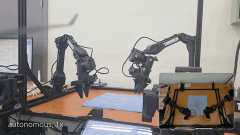
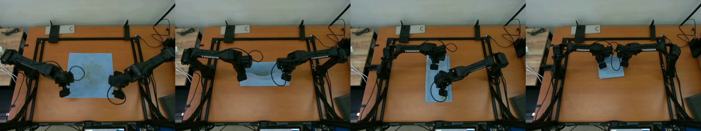
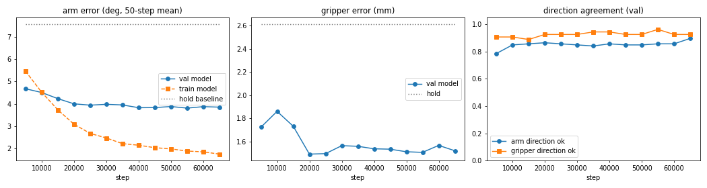
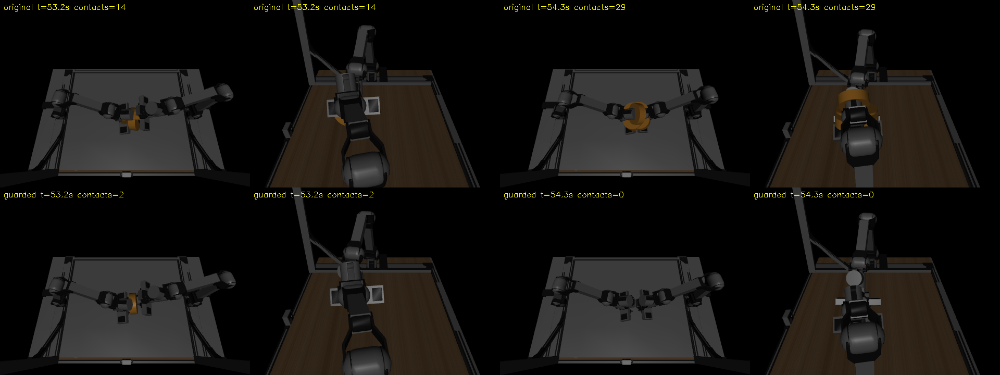

# π0 Towel Folding on Trossen AI Stationary

양팔 로봇(Trossen AI Stationary, WidowX AI ×2)이 펼쳐진 수건을 두 번 접도록 π0를 LoRA로 미세조정하고, 실제 로봇에서 실시간(RTC)으로 실행한 프로젝트입니다.

> **English summary.** Fine-tuned Physical Intelligence's π0 (LoRA) on 148 teleoperated demonstrations to fold a towel twice with a bimanual Trossen AI Stationary robot, and deployed it on the real robot at 30 Hz with Real-Time Chunking. The selected checkpoint (40k steps) completed the fold in 11 of 11 scored trials and ran continuously for 7 min 46 s. This repository holds the training setup, offline validation tooling, the real-robot client (RTC, safety guards, recorder) and the evaluation records.



시연 영상(7분 46초, 편집 없이 1배속): _YouTube 링크 추가 예정_



펼친 수건 → 반 접기 → 90° 돌리기 → 한 번 더 접기. 위 카메라(cam_high)가 본 장면입니다.

## 결과

### 실제 로봇 (2026-11-12, 펼친 수건)

| 체크포인트 | 시도 | 두 번째 접기까지 완료 | 모서리까지 깔끔 |
|---|---|---|---|
| 25,000 스텝 | 3 | 2 | 1 |
| **40,000 스텝** | **11** | **11** | **8** |
| 65,000 스텝 | 6 | 6 | 3 |

- 모든 시도는 사람이 수건을 펼쳐 놓은 뒤 정책이 혼자 실행했습니다. 회차별 기록은 [`finetune/eval/real_robot/pi0_towel_trials.csv`](finetune/eval/real_robot/pi0_towel_trials.csv)에 있습니다.
- 40,000 스텝 체크포인트로는 7분 46초 동안 멈추지 않고, 사람이 수건을 다시 펼쳐 놓을 때마다 이어서 접는 연속 실행도 했습니다(위 영상, 기록 파일의 12회째). 표의 11회에는 넣지 않았습니다.
- 체크포인트별 집계는 [`finetune/real_robot_summary.py`](finetune/real_robot_summary.py)로 냅니다.
- 시도 횟수가 적어서 40,000과 65,000의 "깔끔" 차이(8/11 대 3/6)는 통계적으로 확정된 차이가 아닙니다. 확인된 것은 "40,000 이후로 더 학습해도 실제 로봇에서 나아지지 않았다"는 점입니다.
- 남은 실패는 모두 두 번째 접기의 모서리 정렬입니다(과하게 접음, 모서리 들림, 어긋난 모서리를 고치지 못함).

### 오프라인 검증 (학습에 쓰지 않은 8개 시연)

50스텝(1.67초) 예측을 사람 시연과 비교한 팔 관절 오차입니다. 기준선은 "지금 자세 그대로 있기"(7.57°)입니다.



| 스텝 | 검증 팔 오차 | 학습 시연 팔 오차 |
|---|---|---|
| 5,000 | 4.67° | 5.46° |
| 25,000 | 3.94° | 2.67° |
| 40,000 | 3.82° | 2.14° |
| 65,000 | 3.85° | 1.75° |

검증 오차는 25,000 스텝쯤부터 3.8~4.0°에서 멈췄고, 학습 시연 오차만 계속 내려갔습니다. 그래서 계획한 150,000 스텝 중 69,000 스텝에서 학습을 멈추고 실제 로봇으로 체크포인트를 골랐습니다. 전체 표는 [`finetune/eval/towel_cc_lora_split_report.md`](finetune/eval/towel_cc_lora_split_report.md)에 있습니다.

## 구성

| 항목 | 내용 |
|---|---|
| 로봇 | Trossen AI Stationary: WidowX AI 팔 2대(팔 6관절 + 그리퍼), RealSense 카메라 4대(위·아래·양 손목) |
| 데이터 | 원격 조작 시연 156개(약 78분, 30fps). 학습 148 / 검증 8. 지시문은 모두 `fold towel` |
| 모델 | π0 base + LoRA(`gemma_2b_lora`, `gemma_300m_lora`), batch 8, EMA 끔 |
| 학습 | [TrossenRobotics/openpi](https://github.com/TrossenRobotics/openpi)(JAX), RTX 5090 32GB 1대, 약 1.1초/스텝 |
| 행동 형식 | WidowX AI 절대 관절각(rad)과 그리퍼(m) 그대로. ALOHA 변환 없음. 정규화 값은 이 데이터에서 다시 계산 |
| 실행 | 30Hz 제어. Real-Time Chunking: 50스텝 묶음 중 25스텝마다 다시 계획, 유도 가중치 5, 디노이징 10스텝, 유도 추론 약 108ms |

## 흐름

```
시연 수집 → LeRobot v2.1 변환·검증 분리 → π0 LoRA 학습 ─┬→ 5,000 스텝마다 오프라인 검증 (CPU, 학습과 동시에)
                                                        └→ RTC 정책 서버 → 실제 로봇 클라이언트 → 회차별 점수 기록
```

1. **데이터 변환** — [`finetune/convert_cc_to_v21.py`](finetune/convert_cc_to_v21.py)가 LeRobot v3.0 녹화를 openpi가 읽는 v2.1로 바꾸고, [`finetune/split_val.py`](finetune/split_val.py)가 검증용 8개를 떼어 냅니다.
2. **학습 설정** — [`patches/trossen_openpi.patch`](patches/trossen_openpi.patch)가 Trossen openpi 포크에 `pi0_trossen_towel_cc` 설정을 더합니다. 바꾼 이유는 [`finetune/README.md`](finetune/README.md)에 적었습니다.
3. **오프라인 검증** — [`finetune/eval_watch.py`](finetune/eval_watch.py)가 새 체크포인트가 저장될 때마다 [`eval_val.py`](finetune/eval_val.py)를 CPU에서 돌려 표·그래프·판정(계속 / 과적합 의심 / 정체)을 갱신합니다.
4. **정책 서버** — [`trossen_aloha_real/rtc_server.py`](trossen_aloha_real/rtc_server.py)와 [`rtc_model.py`](trossen_aloha_real/rtc_model.py)가 openpi websocket 서버에 RTC(이전 묶음의 남은 동작과 이어지도록 유도하는 샘플링, Black et al. 2025)를 더합니다.
5. **로봇 클라이언트** — [`trossen_aloha_real/main.py`](trossen_aloha_real/main.py)가 30Hz로 관측을 보내고 명령을 실행합니다. [`broker.py`](trossen_aloha_real/broker.py)는 추론이 도는 동안 이전 묶음을 계속 실행하고, 응답이 오면 지나간 스텝만큼 건너뜁니다.
6. **실제 로봇 평가** — [`serve_pi0_ckpt.sh`](trossen_aloha_real/serve_pi0_ckpt.sh)로 체크포인트를 바꾸고, [`test_pi0_ckpt.sh`](trossen_aloha_real/test_pi0_ckpt.sh)로 한 회 실행한 뒤 도달 단계(잡기 / 1차 접기 / 돌리기 / 2차 접기)와 깔끔 여부를 기록합니다.

## 로봇을 지키는 장치

학습된 정책의 출력을 그대로 믿지 않고, 명령을 보내기 전에 아래를 거칩니다.

- **작업 영역 제한** ([`workspace.py`](trossen_aloha_real/workspace.py)) — 손으로 짚어 잰 점들로 팔마다 상자를 만들고, 그 밖으로 나가는 목표는 경계로 자릅니다.
- **바닥 보호** ([`height_calib.py`](trossen_aloha_real/height_calib.py)) — 손가락 끝이 책상 아래로 가는 명령은 높이를 잘라 냅니다.
- **양팔 충돌 회피** ([`collision.py`](trossen_aloha_real/collision.py), [`collision_model.json`](trossen_aloha_real/collision_model.json)) — 팔을 구 모델로 근사해 두 팔 사이 거리를 매 스텝 계산하고, 가까워지면 비켜 가거나 멈춥니다. 실제 충돌이 났던 실행을 시뮬레이션으로 다시 돌려 검증했습니다.
- **종료 처리** — 정상 종료, 오류, Ctrl+C 모두 준비 자세 → 휴식 자세로 천천히 돌아간 뒤 모터를 풉니다.
- **실행 기록** ([`recorder.py`](trossen_aloha_real/recorder.py)) — 회차마다 위 카메라 영상, 모델 입력 영상, 스텝별 명령·관측을 남깁니다.



충돌이 났던 실행의 재현(위)과, 충돌 회피를 켜고 같은 명령을 넣은 결과(아래)입니다.

## 거쳐 온 시도

| 시도 | 결과 |
|---|---|
| PI가 공개한 `pi0_aloha_towel`을 그대로 실행 (ALOHA ↔ WidowX AI 관절 변환, 카메라 시점 보정) | 수건 근처까지는 가지만 잡는 높이와 위치가 어긋나 접지 못함. 변환·보정 과정은 [`calibration/README.md`](calibration/README.md) |
| **π0 LoRA, 이 로봇의 시연 148개** | **이 저장소의 결과** |
| π0.5 LoRA (LeRobot, 같은 데이터) | 오프라인 팔 오차 6.50°로 π0(3.82°)보다 나빴고, 실제 로봇에서도 쓰기 어려웠음 |

모델별 설정과 결과는 [`docs/experiment_log.md`](docs/experiment_log.md)에 정리했습니다.

## 배운 것

- **오프라인 오차는 걸러내는 용도로만 쓴다.** 검증 오차는 25,000 스텝에서 멈췄는데, 어느 체크포인트가 실제로 더 잘 접는지는 로봇에서 돌려 봐야 알 수 있었습니다. 체크포인트는 단계별 점수를 매긴 실제 실행으로 골랐습니다.
- **정규화 값은 데이터에 맞춰 다시 계산한다.** 기본 모델에 들어 있는 `trossen` 정규화 값은 다른 행동 형식(델타 관절, 그리퍼 0~1)용이라, 그대로 쓰면 행동이 ±15까지 나오고 그리퍼는 거의 학습되지 않습니다.
- **그리퍼 단위를 끝까지 추적한다.** 공개 모델을 실행할 때 그리퍼 변환이 틀려서, 모델은 "닫아라"고 하는데 그리퍼는 60% 열린 채였습니다. 실행 기록에서 그리퍼 명령 최솟값이 항상 같은 값인 것을 보고 찾았습니다.
- **학습과 실행의 지시문을 똑같이 맞춘다.** 학습 도중 지시문을 바꾼 실험에서는 체크포인트마다 맞는 지시문을 따로 챙겨야 했습니다. 지금은 데이터와 실행 모두 `fold towel` 하나로 통일했습니다.
- **RTC 첫 묶음의 지연 보정을 조심한다.** π0.5를 LeRobot의 RTC로 돌릴 때, 로봇이 서서 기다리는 첫 추론에도 "지연된 스텝만큼 건너뛰기"가 적용되어 첫 명령이 현재 자세에서 크게 튀었습니다. 실제로 실행된 스텝만 건너뛰도록 고쳤습니다(그 코드는 별도 프로그램에 있어 이 저장소에는 없습니다).

## 한계와 다음 단계

- 지금은 **반듯하게 펼쳐 놓은 수건**만 접습니다. 최종 목표는 아무렇게나 던져 놓은 수건을 접는 것입니다.
- 다음 단계는 시작 조건을 단계별로 어렵게 하면서(위치·각도 → 살짝 구김 → 한쪽 접힘 → 뭉침) 어디서 무너지는지 재고, 무너지는 단계의 시연과 개입(intervention) 데이터를 모으는 것입니다.
- LoRA 기본 rank만 써 봤습니다. 더 높은 rank나 전체 미세조정과의 비교는 하지 않았습니다.

## 폴더

| 폴더 | 내용 |
|---|---|
| [`trossen_aloha_real/`](trossen_aloha_real) | 실제 로봇 클라이언트, RTC 정책 서버, 보호 장치, 실행·평가 스크립트 |
| [`finetune/`](finetune) | 데이터 변환, 학습 실행, 오프라인 검증, 검증·실제 로봇 결과(`eval/`) |
| [`calibration/`](calibration) | ALOHA ↔ Trossen 좌표·높이·카메라 시점 비교, 충돌 모델 생성 |
| [`collect/`](collect) | 시연 수집 스크립트 |
| [`patches/`](patches) | Trossen openpi 포크에 더한 변경(학습 설정, 카메라 시리얼) |
| [`docs/`](docs) | 모델별 실험 기록 |

데이터셋, 체크포인트, 실행 영상·로그는 용량 때문에 넣지 않았습니다. 스크립트의 경로는 실험한 컴퓨터 기준(`~/pi0_aloha_towel/...`)으로 적혀 있습니다.

## 실행 방법 (요약)

```bash
# 1) Trossen openpi 포크에 학습 설정 적용
git clone https://github.com/TrossenRobotics/openpi.git trossen_openpi
cd trossen_openpi && git apply ../patches/trossen_openpi.patch

# 2) 학습 (처음부터 / 이어서)
./finetune/train.sh
./finetune/train.sh --resume

# 3) 학습과 동시에 오프라인 검증
python finetune/eval_watch.py --kind openpi --exp towel_cc_lora_split --period 5000

# 4) 정책 서버 (로봇에 연결하지 않음)
./trossen_aloha_real/serve_pi0_ckpt.sh 40000

# 5) 실제 로봇 한 회 실행 + 점수 기록 (로봇 앞에서, 비상정지를 쥐고)
./trossen_aloha_real/test_pi0_ckpt.sh
```

## 참고한 것

- [openpi](https://github.com/Physical-Intelligence/openpi) (Physical Intelligence, Apache-2.0) — π0 모델과 학습·서빙 코드. `trossen_aloha_real/main.py`는 openpi의 `examples/aloha_real` 구조를 따랐습니다.
- [TrossenRobotics/openpi](https://github.com/TrossenRobotics/openpi) — Trossen AI용 포크. 학습 설정의 출발점(`pi0_trossen_organize_tools`).
- [LeRobot](https://github.com/huggingface/lerobot) — 로봇·카메라 드라이버와 데이터셋 형식.
- Black et al., "Real-Time Execution of Action Chunking Flow Policies" (2025) — RTC.
- `calibration/compare_views/`의 비교 그림 일부에는 PI가 공개한 `physical-intelligence/aloha_pen_uncap_diverse` 데이터셋의 장면이 들어 있습니다.
